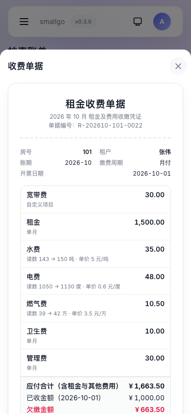
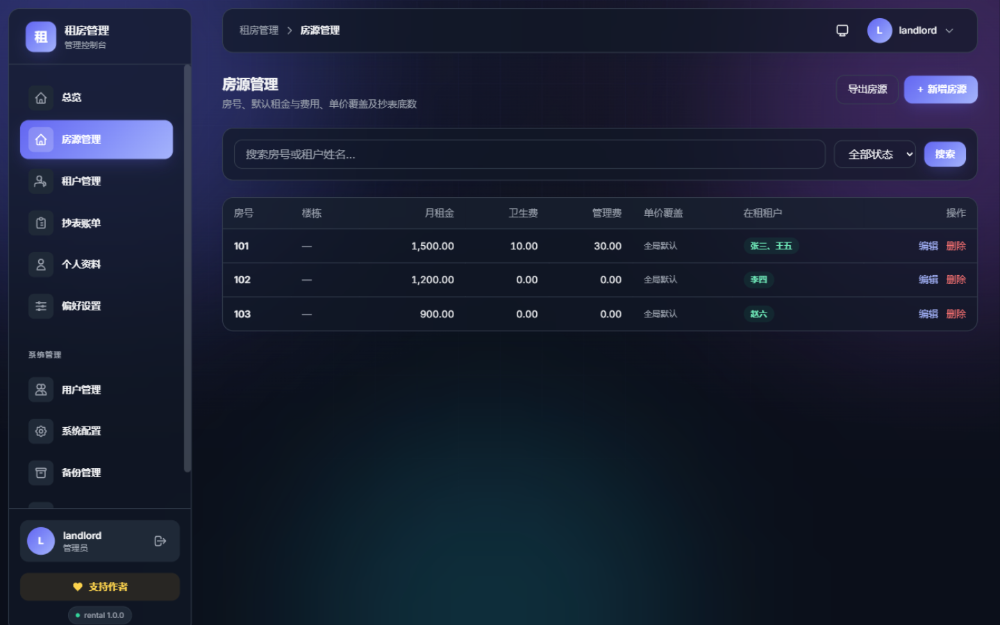
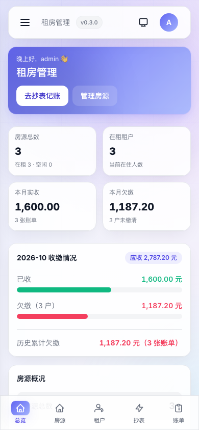
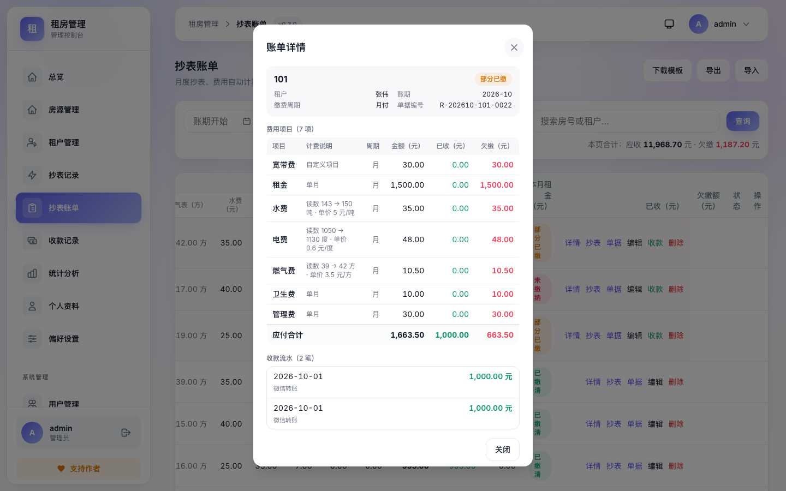
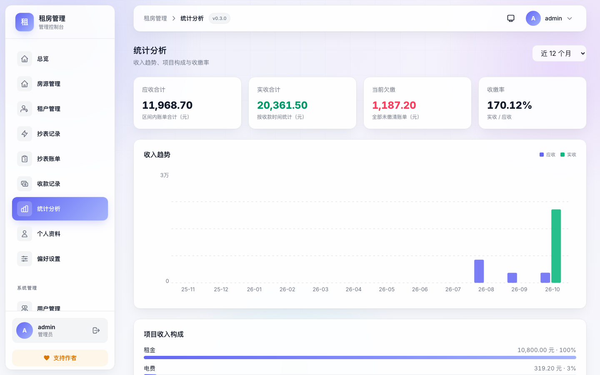

# 租房管理（rental）

[](https://github.com/TechFunWay/rental/releases/latest)
[](LICENSE)
[](https://hub.docker.com/r/techfunways/rental)

面向个人房东、小型公寓运营者、工厂宿舍管理员的租房管理系统：结构化房源、租约到期提醒、月度抄表账单（水电气费用自动计算）、收款与欠缴跟踪、CSV 模板导入导出、收费单据打印；电脑端表格与手机端卡片双布局，支持飞牛 fnOS 一键登录与 Docker 自托管。

> A self-hosted rental management app for landlords, small apartment operators and dorm managers: rooms, tenants, monthly meter readings, bills, payments and receipts — with desktop tables and a mobile card layout. Docker / fnOS NAS ready.

版本功能与修复记录见 [CHANGELOG.md](./CHANGELOG.md)。最新安装包见 [Releases](https://github.com/TechFunWay/rental/releases)。

基于 [smallgo](https://gitee.com/TechFunWay/smallgo) 应用框架实例化（Go/Gin/GORM/SQLite + Vue 3/TS/Vite/Pinia/Tailwind），默认端口 **8910**。

如果这个项目对你有帮助，欢迎[支持作者](#支持作者)。

## 下载与安装

| 渠道 | 获取方式 |
|---|---|
| GitHub Releases | <https://github.com/TechFunWay/rental/releases> —— 各平台压缩包、飞牛 `fpk` 安装包与 `docker-compose.yml` |
| Gitee 发行版 | <https://gitee.com/TechFunWay/rental/releases> —— 国内镜像，产物与 GitHub 一致 |
| Docker 镜像 | `docker pull techfunways/rental:latest`（amd64 / arm64 多平台） |
| 飞牛 fnOS | 在飞牛应用中心手动安装 Releases 里的 `.fpk` 安装包（amd64 / arm64） |
| 官网介绍页 | <https://techfunway.wycto.cn/fnapp/rental> |

> 默认端口 `8910`；数据默认是挂载目录下的 SQLite 单文件，备份即拷贝，恢复支持上传本地备份文件。

## 应用界面

| 总览 | 抄表账单 |
|---|---|
|  |  |

| 收费单据 | 房源管理 |
|---|---|
|  |  |

| 租户管理 | 手机端（总览 / 账单卡片） |
|---|---|
|  |   |

| 账单详情 | 统计分析 |
|---|---|
|  |  |

> 移动端专属布局：底部导航栏、账单/房源/租户卡片式列表、弹窗自适应窄屏；桌面端保持全字段表格。明暗双主题自适应。

## 功能一览

- **房源管理**：按小区/楼栋/单元/楼层/房号结构化录入；默认租金/卫生费/管理费、电/燃气单价覆盖、抄表底数（吨/度/方）；不同小区允许同房号
- **租户管理**：入住/退租，宿舍场景同房多名租户；租约到期时间与剩余天数着色提醒
- **计费与缴费按租户设置**：水费按吨/包月与金额、缴费周期（月付/季付/半年付/年付）、缴费日、提前提醒天数都在租户上填写——每个租户可以不一样；租户没填的项跟随偏好设置里的全局默认，登记租户时表单按全局默认预填
- **合同存档**：每个租户可上传多份合同文件（拍照/扫描件/PDF，≤20MB/个），文件存应用数据目录、读取需登录且校验归属，支持在线预览与下载，退租后记录保留
- **抄表台账**：每房每月的水/电/燃气表读数独立记录，自动算上期差值用量；空置房、非到期月的房子也能记，抄表开票时自动沉淀一条
- **介绍费（房源挂赏金）**：房东可给房源挂介绍费（固定金额或月租金百分比，跟着租金自动算），中介/村委推荐成交后线下结算；平台只标注不经手钱，规则由管理员设（自愿填写 / 最低介绍费 / 无介绍费），列表与详情显示徽标，免登录房源登记页同样可挂
- **平台化与房东入驻**：角色分**系统管理员 / 房东 / 租户**三层；房东注册时提交入驻资料（姓名、电话、地区、房源规模、说明），平台管理员审核通过后开通——通过即拥有自己的个人台账（数据默认隔离），驳回会停用账号且可随时恢复
- **免登录房源登记（村委/中介）**：房源管理里生成台账级「房源登记链接」，发到村民群，村民不用注册登录就能扫码登记要出租的房屋（可带现有租户与照片）；提交进「待审房源」队列，核对后一键建入台账，供查询与推荐空房
- **房源房东信息**：房源可记房东姓名与联系电话（选填），列表显示房东小徽标、详情单列，免登录房源登记通过审核时自动带入登记人信息，方便中介/村委核实与带看
- **房源跨台账移动**：列表每行「移动」可把房源连同租户、入住成员、账单与收款、抄表记录、合同与附件、房间照片整体挪到另一个自己有权限的共同台账（附件文件一起搬迁；移出需完全权限、移入需操作权限）
- **房源详情**：列表每行点「详情」看全这间房——房间照片（可拍多张、点开看大图）、租金与计费口径、入住人身份资料（身份证号/住址/紧急联系人/租约与押金，可复制），历史租客也能展开查看
- **租户与住户成员分开**：每个租户名下可登记同住成员（配偶、子女、父母、同事…），成员只登记身份、**不参与计费**，账单/抄表/收款只按租户算；登记租户的表单里就能「＋ 添加成员」逐行录入、与租户一起保存，之后还可在「成员 n」弹窗里维护；身份证号自动带出生日期与性别，退租时成员自动置为已搬离，总览「在住人数」按租户 + 成员统计
- **抄表照片**：水/电/燃气表盘照片随手拍照留档（每张表最多 6 张），与读数一起按「房间 + 账期」保存；抄表记录列表一键看大图，账单详情里也按表种列出本期照片，现场凭证随时可查
- **月度抄表账单**：一键生成当月账单，自动衔接上月读数；水电气费用 = 用量 × 单价（分位四舍五入）；应付合计 = 租金 + 水电燃气 + 卫生费 + 管理费；支持直填读数
- **房租周期与水电独立**：房租可选月付/季付/半年付/年付（固定费只在到期月按 3/6/12 个月一次收），**水/电/燃气与包月水费始终按月抄表出账**——账单每月一张，非到期月就是只含水电的「月账单」
- **抄表时可直接改租金与备注**：抄表开票弹窗里能改本期租金金额、写备注（如租金对应的租期区间），不用先建账再去账单页编辑
- **缴费提醒**：按租户设置缴费日（1-28 号）与提前提醒天数，总览卡片与导航角标自动汇总临期与逾期；每天 8 点可经钉钉群机器人 / 邮箱 / 短信 / QQ 机器人推送当日汇总（渠道在偏好设置里绑定，绑定目标加密存储）
- **收款与欠缴**：多次收款累加，是否欠缴 / 欠缴额自动判定，欠缴徽标
- **模板导入导出**：CSV 模板下载（Excel 中文无乱码）、账单/房源导出、导入自动建房建租户、同月账单更新
- **租户批量导出**：租户列表按当前筛选一键导出 CSV（派出所要人场景），前 15 列可原样回导，另附在租状态、出生日期、年龄、性别
- **取暖费按供暖季出账**：收费项目可设生效月份（如 11 月→3 月，支持跨年），窗口外的账期不收这项；留空即全年都收
- **登记链接二维码**：房源登记链接可下载成二维码图片，打印贴房门/公告栏，租客扫码即填资料
- **房间物品台账**：每间房记录有什么东西（冰箱/洗衣机/钥匙几把…），标明「房东提供」还是「租客自带」，可写状况与备注、可拍照留档；跟着房间走不跟租客，退租照单核对缺失与损坏
- **少交多交结转**：上期少交自动加进本期应缴、多交自动抵扣（默认关闭，台账设置里按台账开启，只影响开启后新生成的账单）
- **租户资料粘贴识别**：外网不通、登记链接打不开时，租客把资料按「姓名：张三」一行一个字段（中英文冒号都行）写成文字微信发来，房东在「租户管理 → 粘贴识别」里整段粘贴即可本地解析成草稿（不调 AI、不发网络请求），多位租户写在同一条消息里一起识别，核对补全后一键批量入库；认不出的行原样提示，入库规则与 CSV 导入一致
- **收费单据**：单据编号、出租方抬头、缴费周期、明细与合计（含押金与自定义收费项目），浏览器打印 / 另存 PDF
- **押金单照片**：押金不再只录一个数字——租户列表押金列、登记/编辑租户表单里可直接拍押金单实物留档，按租户保存、可看大图与删除，退租结算与对账有据可查
- **抄表开票预览**：开票前就把自定义收费项目（宽带费/停车费等）、首张押金与上期结转列进「本期应缴」，与保存后的账单口径一致；抄表记录列表带出本期账单金额并单列自定义收费合计
- **数字带单位**：读数（吨/度/方）与单价（元/吨、元/度、元/方、元/月）在列表、弹窗与单据上都带单位显示
- **框架能力**：登录认证、飞牛 NAS 一键登录、用户管理、系统配置、备份恢复、审计日志、版本检查、明暗主题、赞赏支持
- **自定义收费项目**：除租金/水/电/燃气/卫生/管理六项外可自建收费项目（宽带费、停车费等），每项可设固定金额与月付/季付周期、可停用
- **按项目周期出账**：读数类项目按月收，固定费项目按缴费周期到期才收；多月周期租户的非到期月出「月账单」、到期月出对应周期账单，一键出账每月都能开出不漏抄水电
- **租户收费项目勾选**：登记租户时逐项勾选是否参与结算（如不收卫生费、燃气），被排除的项目在账单与单据中计 0；租户档案另含身份证号
- **收款流水与统计分析**：每次收款单独记录并按项目分摊，收款弹窗可按项目勾选；新增收款记录页与统计分析页（汇总卡、收入趋势、项目构成）
- **空置分析**：实时空置清单（空置房数、空置率）与按月空置趋势、按房源排行，估算空置造成的收益损失；历史空置按入住/退租日期重建并如实标注估算口径
- **账单详情**：账单可查看逐项费用（计费说明、周期、金额、已收、欠缴）与收款流水分摊明细
- **租客登录与只读门户**：租客在注册页选「我是租客」自己注册账号，房东在「租户管理」里把它关联到对应租户档案（关联即开通）后，租客登录即可查看**只属于自己**的登记资料、月度账单与明细（可看单据）、缴费记录与租赁合同；租客不是台账成员，看不到别人的数据，也不能改任何业务数据
- **租户资料变更申请**：租客可申请修改手机号、身份证号、身份证住址、紧急联系人与证件照，**提交后不立即生效**；房东在「租户管理 → 资料变更申请」里逐项对照正式值与申请值，通过才覆盖正式资料，也可驳回并写明理由（驳回/撤回会删除本次上传的证件照）

## 技术栈

- 后端：Go + Gin + GORM + SQLite（WAL，`CGO_ENABLED=1`）
- 前端：Vue 3 + TypeScript + Pinia + Vue Router + Tailwind CSS + Vite
- 部署：Docker（多平台）、飞牛 fnOS `.fpk`、裸二进制

## 快速开始

### 源码运行

```bash
# 后端（默认 :8910）
cd server && go run .

# 前端开发（:3000，代理 /api 与 /uploads 到 :8910）
cd web && npm ci && npm run dev

# 生产构建（前端必须先于后端）
make build

# 运行
./rental -data-dir ./data -web-dir ./static/dist -port 8910
```

首次启动注册的第一个用户为管理员。业务数据存储于 `data/db/rental.db`（SQLite，WAL）。

### Docker

```bash
# 构建本地镜像
make build-docker          # 当前机器架构
make build-docker-multi    # linux/amd64 + linux/arm64 合并本地 OCI

# 或使用发行目录中的 compose
cd release/v0.3.0   # 或解压 Release 资产后的目录
docker compose up -d
```

浏览器访问 `http://localhost:8910`。

### 飞牛 fnOS

在 [Releases](https://github.com/TechFunWay/rental/releases) 下载对应架构的 `.fpk`：

- `techfunway-rental_v0.3.0_x86.fpk`（Intel / x86_64 NAS）
- `techfunway-rental_v0.3.0_arm64.fpk`（ARM64 NAS）

### 各平台压缩包

Releases 中同时提供 Windows / macOS / Linux 的二进制压缩包，解压后带上 `www/` 静态资源即可运行。

## 业务数据规则

| 规则 | 说明 |
|---|---|
| 费用计算 | 用量 = max(0, 本月读数 − 上月读数)；费用 = 用量 × 单价，四舍五入到分 |
| 计费与缴费来源 | 租户设置 → 偏好设置中的全局默认（水费按吨/包月与金额、缴费周期、缴费日、提醒天数）；房间生效值取该房在租租户的设置，同房多名租户时逐项取第一个显式设置的租户 |
| 单价优先级 | 账单行内单价 > 房间覆盖价（电/燃气）> 偏好设置中的全局默认价 |
| 读数衔接 | 生成新账单时“上月读数”自动取上一期账单的“本月读数”，无历史则取房间底数 |
| 欠缴判定 | 应付合计 − 已收 > 0 即欠缴；差额为欠缴额（半分容差） |
| 删除保护 | 存在账单的房源不可删除；账单删除需二次确认 |
| 角色划分 | 管理员 / 出租人（房东）/ 租户三种。租户只能进「租客服务」，业务接口一律拒绝；出租人按台账 × 模块勾选权限 |
| 租户可见范围 | 只显示「本人所在房源 + 开票时姓名快照命中本人 + 账期落在入住/退租区间内」的账单，以及自己名下的合同与资料附件；换租客后前任的账单不会串到新租客 |
| 租户可改字段 | 手机号、身份证号、身份证住址、紧急联系人、紧急联系电话、证件照；姓名/房间/租金/租期/押金/计费设置由房东维护 |
| 变更生效方式 | 租户提交申请 → 房东审核通过 → 只覆盖申请里填写了内容的字段（留空表示本次不改）|

## 构建 fnOS / Docker

```bash
make build-all          # 五平台压缩包 + 截图 + compose 到 release/v<版本>/
make fnpack             # 飞牛 .fpk（x86 + arm64），需 Docker 与 fnpack
make build-docker-multi # 本地多平台合并镜像 OCI 归档
```

## 与上游框架同步

框架层文件与 smallgo 基线保持一致，业务代码集中在 `server/rental/` 与 `web/src/views|api`。检查漂移：

```bash
./scripts/check-sync.sh .
```

## 支持作者

本应用免费、无广告，所有数据都保存在你自己的设备上。如果它对你有帮助，欢迎请作者喝杯咖啡——金额随意，1 元也是心意；不赞赏也不影响任何功能。

<p align="center">
  
</p>

支付后可在应用内「支持作者」弹窗中点击【已支持】，填写赞赏金额（预设 1/5/10/50 元或自行输入）后发送一次匿名支持计数（仅设备统计信息与金额标注，与微信账号和支付记录无任何关联）。

## 许可证

本项目以开源方式发布，详见 [LICENSE](LICENSE)。
